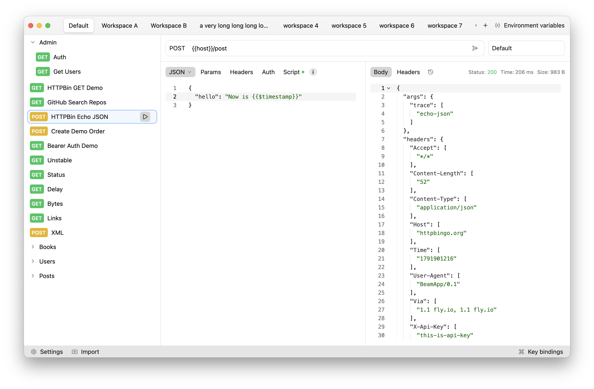

# Beam

A HTTP client for developers built with Rust and gpui and gpui-component.



## Features

- Native, local-first, no telemetry
- Multi-workspace organization with folders and requests
- Drag and drop requests to reorder them or move them between folders
- HTTP request with common methods (GET, POST, PUT, DELETE, PATCH, HEAD, QUERY, and OPTIONS)
- Authentication support for Bearer, Basic, and API Key (header or query)
- Request body formats for JSON, XML, Text, GraphQL, Form URL-Encoded, and Multipart
- Environments variable `{{variable}}` and built-in dynamic variables resolving
- Post-response JavaScript scripting with console output, tests, and environment updates
- Import Postman collections and environments, plus Insomnia JSON and v5 YAML exports
- Paste cURL commands into the URL field to populate the current request
- Command palette for quickly opening requests, revealing folders, and running common commands
- Response history view in the response pane
- Persistent TOML-based storage for workspaces, requests, environments, local history, and script results on your machine
- Theme support with light/dark mode and font size settings
- Manual application updates from normal releases or nightly builds
- Editor auto-format, soft wrap, wrapping indent settings

## Installation

### macOS and Linux

Install the latest stable release for your user (macOS Apple Silicon or Linux x86_64):

```bash
curl --proto '=https' --tlsv1.2 -sSfL https://github.com/hlcfan/beam/releases/latest/download/install.sh | sh
```

The installer detects your platform and verifies the release's SHA-256 checksum
(this detects corruption, not a tampered release). No sudo is needed.

- **macOS:** Installs to `~/Applications/Beam.app` and runs `xattr -cr` on the
  verified app bundle to clear quarantine attributes.
- **Linux:** Installs to `~/.local/bin` and adds an application launcher and icon.
  Add `~/.local/bin` to your `PATH` to run `beam` from a terminal.

Quit Beam before reinstalling. Use Beam's in-app updater or rerun the command to
update, then reopen Beam. The installer becomes available once a release containing
`install.sh` and the desktop assets is published.

The installer requires `curl`, `tar`, and standard platform utilities. It does not
install system libraries; Linux requires a graphical desktop with GTK 3,
WebKitGTK 4.1, and the platform libraries used by GPUI.

#### Manual installation

On macOS:

```bash
tar -xzf beam-macos-aarch64.tar.gz
mkdir -p "$HOME/Applications"
mv beam-macos-aarch64/Beam.app "$HOME/Applications/"

# If Gatekeeper blocks the ad-hoc signed app, remove its quarantine attribute:
xattr -cr "$HOME/Applications/Beam.app"
```

On Linux:

```bash
tar -xzf beam-linux-x86_64.tar.gz
./beam-linux-x86_64/beam
```

#### Uninstall

Workspace data is retained. On macOS, move `~/Applications/Beam.app` to the Trash.
On Linux:

```bash
rm -f "$HOME/.local/bin/beam"
rm -f "${XDG_DATA_HOME:-$HOME/.local/share}/applications/com.hlcfan.beam.desktop"
rm -f "${XDG_DATA_HOME:-$HOME/.local/share}/icons/hicolor/512x512/apps/com.hlcfan.beam.png"
rm -f "${XDG_DATA_HOME:-$HOME/.local/share}/metainfo/com.hlcfan.beam.metainfo.xml"
```

### Windows

Download and run `beam-windows-x86_64-setup.exe` from the
[latest release](https://github.com/hlcfan/beam/releases/latest). It installs for
your user in `%LOCALAPPDATA%\Programs\Beam`, adds a Start Menu shortcut, and
registers an uninstaller in Windows Settings. No administrator access is needed.
Quit Beam before reinstalling. Use the in-app updater or rerun the installer to update.
Uninstalling retains your workspace data. The installer is not code-signed, so
SmartScreen may warn; verify it against the published `.sha256`.

For a portable copy, extract `beam-windows-x86_64.zip` and run `beam.exe`.

## Importing

Open **Import** from the status bar, then select one or more files or a folder. Beam detects and imports:

- Postman collections v2.0 and v2.1
- Postman environments
- Insomnia JSON exports
- Insomnia v5 YAML collections

Multiple files can be imported as one batch. When a batch contains multiple collections, Beam keeps each collection in its own top-level folder. Insomnia workspace exports create a new workspace; collections and environments import into the active workspace.

Multiple workspace exports can be imported together, but they cannot be combined with separate Postman environment files because the target workspace would be ambiguous.

You can also paste a cURL command directly into the request URL field to fill the current request's method, URL, headers, query parameters, authentication, and body.

## Privacy

Beam is local-first. It stores your data in local TOML files on your machine so you can inspect, back up, and manage it yourself.

Beam does not send telemetry or analytics data. There is no account requirement and no cloud dependency for core usage.

## Development

### Prerequisites

- Rust 1.70+

### Build

```bash
cargo build
```

### Run

```bash
cargo run
```

### Test

```
cargo test
```

## License

GPL-3.0.
